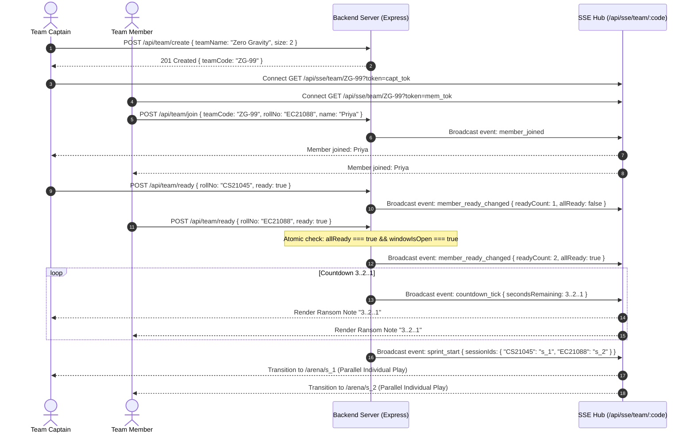
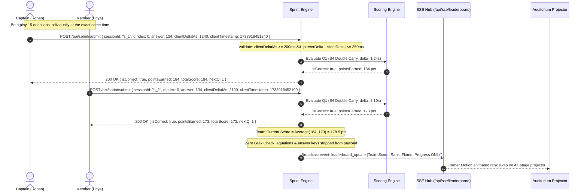
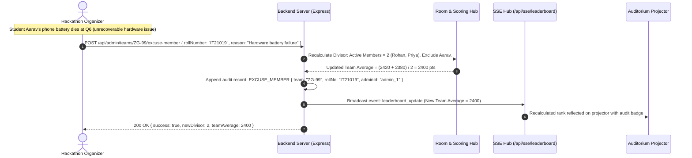
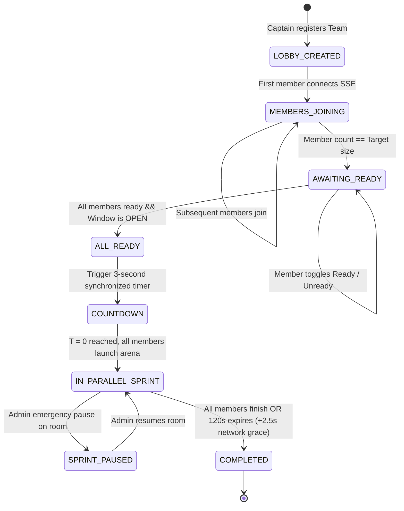
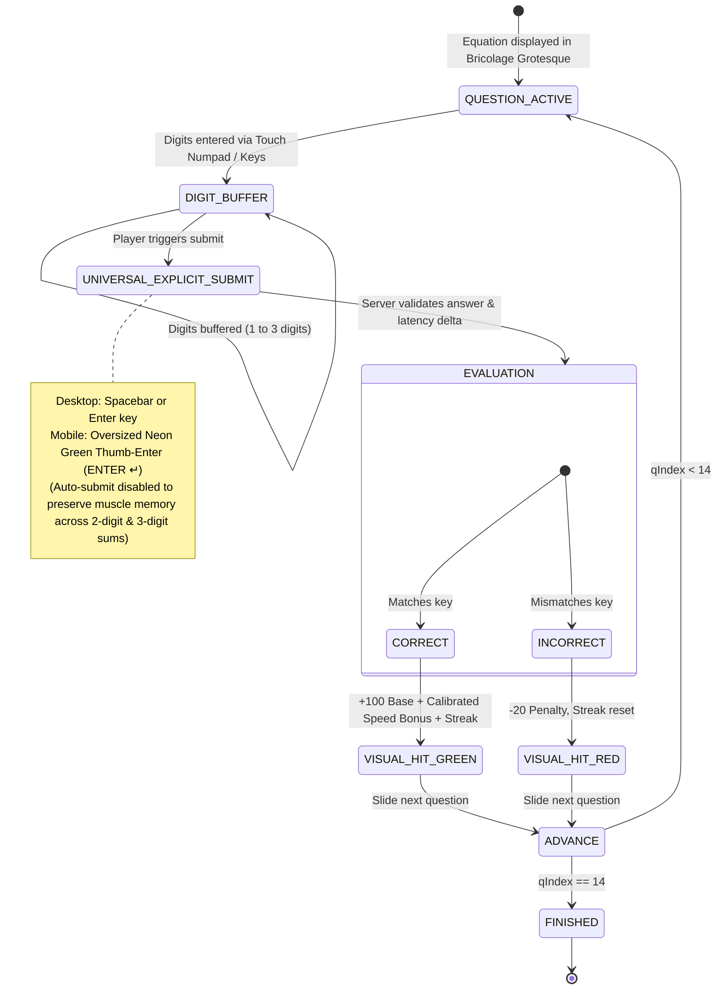

# MATIKS HACKATHON ENGINE — TECHNICAL ARCHITECTURE (ARCHITECTURE.md)

> **Document Version:** 2.0.0  
> **System Purpose:** High-concurrency, zero-luck, team-synchronized speed mental math competition platform.  
> **Target Environment:** College hackathons, campus Wi-Fi networks, 4K auditorium projectors, mobile & desktop browsers.

---

## 1. System Topology Overview

The Matiks Hackathon Engine is an event-driven, decoupled client-server architecture. It replaces duplex WebSockets with **Unidirectional Server-Sent Events (SSE) + RESTful HTTP**, guaranteeing 100% firewall pass-through and connection survival across congested college Wi-Fi access points.

```
┌────────────────────────────────────────────────────────────────────────────────────────────────────────┐
│                                              CLIENT TIER                                               │
│                                                                                                        │
│   ┌────────────────────────┐  ┌────────────────────────┐  ┌─────────────────┐  ┌───────────────────┐   │
│   │   Team & Member Lobby  │  │   2-Min Combat Arena   │  │   Admin Panel   │  │ 4K Stage Projector│   │
│   │   (`/?team=:teamCode`) │  │  (`/?team=:code&arena`)│  │   (`/admin`)    │  │  (`/leaderboard`) │   │
│   └───────────┬────────────┘  └───────────┬────────────┘  └────────┬────────┘  └─────────▲─────────┘   │
└───────────────┼───────────────────────────┼────────────────────────┼─────────────────────┼─────────────┘
                │ 1. POST /api/team/*       │ 2. POST /api/sprint/*  │ 3. /api/admin/*     │ 4. SSE Stream
                │    (Join, Ready, Reset)   │    (Submit Answer)     │    (Window, Export) │    (text/event-stream)
                ▼                           ▼                        ▼                     │
┌──────────────────────────────────────────────────────────────────────────────────────────┴─────────────┐
│                                         NETWORKING & ROUTING TIER                                      │
│                                                                                                        │
│                    Reverse Proxy / Express HTTP Server (CORS, JSON Parser, Rate Limiter)               │
└───────────────────────────────────────────────────┬────────────────────────────────────────────────────┘
                                                    │
┌───────────────────────────────────────────────────▼────────────────────────────────────────────────────┐
│                                            BACKEND CORE SERVICES                                       │
│                                                                                                        │
│  ┌────────────────────────┐  ┌────────────────────────┐  ┌──────────────────┐  ┌───────────────────┐   │
│  │  Room & Team Sync Hub  │  │ 4-Bucket Math Engine   │  │ Scoring & Latency│  │ Contest Window    │   │
│  │  (Atomic Ready State)  │  │ (Wide-Corridor O(1))   │  │ Validation Engine│  │ Lifecycle Manager │   │
│  └───────────┬────────────┘  └───────────┬────────────┘  └─────────┬────────┘  └─────────┬─────────┘   │
│              │                           │                         │                     │             │
│              └───────────────────────────┼─────────────────────────┴─────────────────────┘             │
│                                          ▼                                                             │
│  ┌──────────────────────────────────────────────────────────────────────────────────────────────────┐  │
│  │                                 SSE EVENT DISPATCHER & PUB/SUB BUS                               │  │
│  │                                                                                                  │  │
│  │   • Channel: `/api/sse/team/:teamCode?token=x` (Roster, Ready, Countdown, sprint_resume, HUD)    │  │
│  │   • Channel: `/api/sse/leaderboard`           (Realtime Score Swaps, Podium Changes, Ticker)     │  │
│  │   • Channel: `/api/sse/admin?ticket=x`        (Telemetry Logs, Anti-Cheat Anomalies, Sessions)   │  │
│  └───────────────────────────────────────┬──────────────────────────────────────────────────────────┘  │
└──────────────────────────────────────────┼─────────────────────────────────────────────────────────────┘
                                           │
┌──────────────────────────────────────────▼─────────────────────────────────────────────────────────────┐
│                                          DATA & STATE STORE                                            │
│                                                                                                        │
│   ┌──────────────────────────────────────────────────┐ ┌────────────────────────────────────────────┐  │
│   │             In-Memory High-Speed Cache           │ │   Crash-Safe Persistence (`statePersistence`)│ │
│   │  • Active Rooms, Member Tokens & Ref-Counts      │ │  • Debounced Atomic `.tmp` + Rename Writes │  │
│   │  • Active Parallel Sprints & Per-Squad History   │ │  • Restores Rooms, Sprints & Leaderboard   │  │
│   │  • Sorted Leaderboard Priority Queue (Team Avg)  │ │  • RFC-4180 CSV & JSON Tournament Exports  │  │
│   └──────────────────────────────────────────────────┘ └────────────────────────────────────────────┘  │
└────────────────────────────────────────────────────────────────────────────────────────────────────────┘
```

---

## 2. Directory & Component Architecture

```
Matiks/
├── .github/workflows/
│   └── ci.yml                            # GitHub Actions CI (Server Tests, Client Tests, Oxlint, Vite Build)
├── client/                               # React 19 + Vite + Tailwind CSS v4 Frontend
│   ├── src/
│   │   ├── components/
│   │   │   ├── admin/
│   │   │   │   └── AdminView.jsx         # Organizer Command Center, Window Controls, Anomaly Feed, CSV/JSON Export
│   │   │   ├── arena/
│   │   │   │   ├── ArenaView.jsx         # 2-Minute Math Combat Arena (60fps Reflex Mode) & Summary
│   │   │   │   ├── Numpad.jsx            # Tactile mobile on-screen numpad with oversized Thumb-Enter
│   │   │   │   └── TeammateHud.jsx       # Live partner progress pills
│   │   │   ├── common/
│   │   │   │   ├── ConfirmModal.jsx      # Custom UFC neo-brutalist confirmation modal
│   │   │   │   ├── FilmGrain.jsx         # SVG fractal noise procedural overlay
│   │   │   │   ├── Navbar.jsx            # Top navigation bar with sound toggle & active squad badge
│   │   │   │   ├── RadarDot.jsx          # Pulsing neon status indicator
│   │   │   │   ├── RansomTile.jsx        # Multi-typeface paper scrap lettering
│   │   │   │   ├── StatusBanner.jsx      # Contest window & ticker banner
│   │   │   │   ├── TactileButton.jsx     # Neo-brutalist tactile sticker button (.btn)
│   │   │   │   └── WashiTape.jsx         # Slanted decorative tape strips
│   │   │   ├── leaderboard/
│   │   │   │   └── LeaderboardView.jsx   # 4K Auditorium Projector View & Top-3 Podium
│   │   │   └── lobby/
│   │   │       ├── CountdownOverlay.jsx  # Synchronized 3-2-1 Ransom note countdown
│   │   │       ├── TeamLobby.jsx         # Live member roster, ready gate, rematch & leave controls
│   │   │       └── TeamOnboarding.jsx    # Create or join squad onboarding panel
│   │   ├── services/
│   │   │   ├── api.js                    # REST client with auth header injection & error normalization
│   │   │   ├── soundFx.js                # Web Audio API procedural sound synthesizer
│   │   │   └── sse.js                    # Resilient EventSource manager with watchdog & visibility resync
│   │   ├── App.jsx                       # Root state coordinator, history routing & session storage sync
│   │   └── index.css                     # UFC design tokens (--ink, --signal, --butter, --ember) & utility classes
│   ├── tests/
│   │   └── clientSuite.test.mjs          # Frontend unit tests (api.js, sse.js, soundFx.js, fault tolerance)
│   └── package.json
│
├── server/                               # Node.js + Express + TypeScript Backend
│   ├── src/
│   │   ├── controllers/
│   │   │   ├── adminController.ts        # Window controls, pause/resume, excuse, tickets, CSV/JSON exports
│   │   │   ├── authController.ts         # Pluggable player/admin login & club membership validation
│   │   │   ├── sprintController.ts       # Answer submission & authoritative clock sync
│   │   │   ├── sseController.ts          # Team, Leaderboard, and Admin SSE stream handlers
│   │   │   └── teamController.ts         # Team creation, join, ready toggle, leave, and rematch reset
│   │   ├── services/
│   │   │   ├── authProvider.ts           # LocalHackathonAuthProvider & ClubOidcAuthProvider
│   │   │   ├── leaderboardManager.ts     # Sorted priority queue with 50ms broadcast coalescing
│   │   │   ├── mathEngine.ts             # Pre-sorted Int32Array wide-corridor O(1) non-repeating generator
│   │   │   ├── roomManager.ts            # Room state machine, atomic ready gate, per-squad history, recovery
│   │   │   ├── scoringEngine.ts          # Difficulty-calibrated speed bonus & streak multipliers
│   │   │   ├── sseHub.ts                 # SSE connection registry, 15s keepalive, anti-buffering headers
│   │   │   ├── statePersistence.ts       # Debounced atomic disk snapshot persistence & crash recovery
│   │   │   └── windowManager.ts          # Hackathon contest window lifecycle manager
│   │   ├── types/
│   │   │   ├── auth.ts                   # Auth contracts & session claims
│   │   │   ├── game.ts                   # Question, TeamRoom, SprintSession, AuditRecord models
│   │   │   └── sse.ts                    # SSE event payload schemas
│   │   ├── app.ts                        # Express app factory, CORS, rate limiters, route mounting
│   │   └── index.ts                      # HTTP server bootstrap, state restoration & graceful shutdown
│   ├── tests/
│   │   ├── authOidc.test.ts              # Local & Club OIDC authentication tests
│   │   ├── chaosNetworkTest.ts           # Jitter, deadline grace, disconnect & visibility resync tests
│   │   ├── loadTest.ts                   # 30 teams / 90 students / 100 SSE streams / 1,350 submissions benchmark
│   │   ├── mathEngine.test.ts            # 4-bucket taxonomy, 1,000-sprint Monte Carlo & non-repetition tests
│   │   ├── phase2Integration.test.ts     # Full room state machine & realtime SSE integration tests
│   │   ├── qaRegression.test.ts          # Edge-case regression suite (leave, rematch, sprint_resume, fuzzing)
│   │   ├── servicesUnit.test.ts          # Unit tests for Leaderboard, Window, SseHub, Persistence, CSV escaping
│   │   └── smoke.test.ts                 # End-to-end HTTP + SSE smoke test suite
│   ├── tsconfig.json
│   └── package.json
│
├── AGENTS.md                             # Multi-agent engineering specification
├── ARCHITECTURE.md                       # This document
├── DESIGN.md                             # UFC visual identity & movement spec
├── MATH_ENGINE.md                        # Zero-luck 4-bucket taxonomy & proofs
├── MEMORY.md                             # Architectural decisions & requirements log
├── PHASES.md                             # Implementation roadmap & phase exit criteria
├── README.md                             # Master project overview & quick-start guide
└── SSE_PROTOCOL.md                       # SSE event schemas & transport contracts
```

---

## 3. Data Flow & Communication Lifecycles

### Flow A: Team Joining, Atomic Ready Gate & Synchronized Countdown



---

### Flow B: Parallel Individual Sprint Combat & Team Average Scoring



---

### Flow C: Hardware Failure / Disconnect Recovery (`[EXCUSE MEMBER]`)



---

## 4. State Machine Specifications

### A. Team Room Lifecycle State Machine



---

### B. Per-Player Combat State Machine (Reflex Mode)



---

## 5. Core Data Models (TypeScript Interfaces)

```typescript
// 1. Math Question Model
export interface Question {
  id: number;
  bucket: 'B1' | 'B2' | 'B3' | 'B4'; // 4-Bucket Carry Taxonomy
  a: number;                         // 10 <= a, b <= 99 (no 0-endings, no double-5 endings)
  b: number;
  answer: number;                    // Target sum: a + b
  carries: 0 | 1 | 2;
  targetLatencySeconds: number;      // 3.5s (B1), 5.5s (B2), 6.0s (B3), 8.0s (B4)
}

// 2. Team Member Model
export interface TeamMember {
  rollNumber: string;                // e.g. "CS21045"
  name: string;
  isCaptain: boolean;
  isReady: boolean;
  connected: boolean;
  activeSessionId?: string;
  individualScore: number;
  individualCompleted: number;
  lastHeartbeat: number;
}

// 3. Team Room State
export interface TeamRoom {
  teamCode: string;                  // e.g. "ZG-99"
  teamName: string;
  targetSize: number;                // Configured size (2 to 4)
  members: Map<string, TeamMember>;
  status: 'LOBBY' | 'AWAITING_READY' | 'COUNTDOWN' | 'IN_SPRINT' | 'PAUSED' | 'FINISHED';
  isPaused: boolean;
  pausedAt?: number;
  createdAt: number;
}

// 4. Individual Sprint Session Model
export interface SprintSession {
  sessionId: string;
  teamCode: string;
  rollNumber: string;
  startedAt: number;
  expiresAt: number;                 // startedAt + 120,000ms
  questions: Question[];             // Normalized 15-question set
  submissions: SubmissionRecord[];
  currentScore: number;
  consecutiveStreak: number;         // 1x, 1.1x, 1.25x, 1.5x
  completedQuestions: number;
  isFinished: boolean;
}

// 5. Answer Submission Record
export interface SubmissionRecord {
  questionIndex: number;
  submittedAnswer: number;
  isCorrect: boolean;
  latencyMs: number;
  pointsAwarded: number;
  timestamp: number;
}

// 6. Realtime Leaderboard Entry (Team Score = Average of Members)
export interface LeaderboardEntry {
  rank: number;
  teamCode: string;
  teamName: string;
  teamAverageScore: number;          // Average of all team members
  memberScores: { rollNumber: string; name: string; score: number }[];
  averageTimeSeconds: number;
  status: 'IN_SPRINT' | 'FINISHED';
}

// 7. Contest Window Configuration
export interface ContestWindow {
  isOpen: boolean;
  opensAt: number;
  closesAt: number;
  durationMinutes: number;
  announcementTicker?: string;
}
```

---

## 6. Campus Wi-Fi Resiliency & Network Guarantees

1. **Enterprise Firewall Pass-Through:**
   * SSE uses standard `HTTP 200` with `text/event-stream`, bypassing WebSocket handshake bans on campus networks.
2. **Stateful NAT Keepalive:**
   * Server sends `:keepalive [timestamp]\n\n` comments every 15 seconds.
3. **Tab Sleep & Background Recovery:**
   * Client tracks `document.visibilityState`. When a student returns from a minimized tab, the client immediately requests `/api/sprint/sync` to restore exact server timestamps.
4. **Proxy Buffering Suppression:**
   * Server sends `X-Accel-Buffering: no` to prevent Nginx/Cloudflare reverse proxies from caching live SSE streams.

---

## 7. Security & Anti-Cheat Subsystem

1. **Strict Server Authority & Network Transit Grace:**
   * The sprint timer is strictly anchored to the server's high-resolution timer.
   * Client transmits `{ submittedAnswer, clientDeltaMs, clientTimestamp }`.
   * Server validates that the submission occurred before the 120.0s deadline on the client, granting a $+2.5\text{s}$ network transit grace to ensure laggy campus Wi-Fi packets are not unfairly rejected.
   * Server verifies latency jitter: $| \text{serverDeltaMs} - \text{clientDeltaMs} | \le 350\text{ ms}$.
2. **Sub-200ms Bot Anomaly Detector:**
   * Submissions where `clientDeltaMs < 200` are flagged automatically in the Organizer Telemetry Stream (`/api/sse/admin`) to catch client-side script injection or bot automation.
3. **One Attempt per Roll Number:**
   * Roll numbers are atomically locked upon sprint initiation. Duplicate logins or concurrent attempts are rejected with `409 Conflict`.
4. **Answer Key Protection & Zero Question Leak Guarantee:**
   * The sprint client receives only problem operands ($A, B$). Verification is executed 100% server-side.
   * The auditorium projector SSE stream (`/api/sse/leaderboard`) broadcasts macro metrics exclusively (Team Name, Rank, Team Average Score, Question Progress $Q/15$, and Streak Flame). Operands, questions, and answers are strictly stripped from all public broadcasts.
5. **Deterministic $\mathcal{O}(1)$ Residual Math Generation:**
   * Prevents server thread exhaustion during concurrent room starts by utilizing the $\mathcal{O}(1)$ residual-targeted blueprint generator described in [MATH_ENGINE.md](MATH_ENGINE.md).
6. **Hardware Failure Recovery (`[EXCUSE MEMBER]`):**
   * If a student experiences an unrecoverable device crash or dead battery, an admin can execute `POST /api/admin/teams/:teamCode/excuse-member` to remove that student from the score divisor without corrupting the rest of the team's average. Every action is recorded in an immutable append-only audit trail.

---

## 8. Pluggable Auth Architecture & Club OIDC Blueprint

To accommodate the ongoing development of the USAR FOSS Club's central authentication system, the authentication and permission subsystem is structured as a pluggable adapter pattern:

```
                          ┌───────────────────────────┐
                          │   IAuthProvider Interface │
                          └─────────────┬─────────────┘
                                        │
           ┌────────────────────────────┴───────────────────────────┐
           ▼                                                        ▼
┌─────────────────────────────────────┐  ┌──────────────────────────────────────┐
│  Phase 1: LocalHackathonAuthProvider│  │   Phase 2: ClubOidcAuthProvider      │
│  (Current Operational Mode)         │  │   (Future Integration Target)        │
├─────────────────────────────────────┤  ├──────────────────────────────────────┤
│ • Zero-barrier student onboarding   │  │ • OIDC / OAuth2 against fossclub.tech│
│ • College Roll Number + Display Name│  │ • Fetches /api/members/:id endpoint  │
│ • Pre-shared ADMIN_SECRET passcode  │  │ • Verifies verified club membership  │
│ • Mockable role & membership flags  │  │ • Enforces team roster permissions   │
└─────────────────────────────────────┘  └──────────────────────────────────────┘
```

### A. The Common Auth Contract (`authTypes.ts`)
```typescript
export interface AuthUser {
  id: string;                        // Unique student ID or GitHub ID
  rollNumber: string;                // Primary academic identifier
  displayName: string;
  isClubMember: boolean;             // Verified UFC member status
  teamCode?: string;                 // Associated team room
  role: 'participant' | 'captain' | 'admin';
}

export interface IAuthProvider {
  loginPlayer(credentials: { rollNumber: string; name: string; teamCode: string }): Promise<AuthUser>;
  loginAdmin(credentials: { passcode: string }): Promise<AuthUser>;
  verifySession(token: string): Promise<AuthUser | null>;
  validateClubMembership(userId: string): Promise<boolean>;
}
```

### B. Phase 1: Local Hackathon Auth (Current Stage)
* **Student Onboarding:** Enters Roll Number, Name, and Team Code directly in the lobby without external redirects.
* **Admin Gate:** Access protected via `process.env.ADMIN_SECRET` in HTTP header `x-admin-key`.
* **Mock Hooks:** Includes a mock `isClubMember` flag and testing roles so team-based permission checks can be validated today.

### C. Phase 2: Future Club OIDC Flow (Ready for Drop-in)
When the central club website (`fossclub.tech`) completes its OIDC endpoints:
1. **Authorization Code Flow:** Client redirects to `https://www.fossclub.tech/oauth/authorize?client_id=matiks&redirect_uri=...`.
2. **Token & Claims Retrieval:** Server exchanges code at `/api/auth/token` for JWT claims containing the student's GitHub ID and registered roll number.
3. **Membership Check:** Queries the club's member endpoint (`GET https://www.fossclub.tech/api/dashboard/members`) to ensure the student is an authorized club member or registered hackathon team participant.
4. **Zero Refactoring Needed:** The core game engine, room manager, scoring, and SSE channels depend solely on `IAuthProvider`, meaning switching from Phase 1 to Phase 2 requires changing a single environment flag:
   ```env
   AUTH_MODE=club_oidc # Swapped from AUTH_MODE=local
   CLUB_OIDC_ISSUER_URL=https://www.fossclub.tech
   CLUB_OIDC_CLIENT_ID=matiks_hackathon
   CLUB_OIDC_CLIENT_SECRET=...
   ```

---

## 11. Matiks 2.0 Architectural Enhancements

```
┌──────────────────────────────────────────────────────────────────────────────────────────────────┐
│                                   MATIKS 2.0 ENHANCEMENT ARCHITECTURE                            │
├────────────────────────────────┬────────────────────────────────┬────────────────────────────────┤
│ 1. REALTIME & REPLAY BUFFER    │ 2. OBSERVABILITY ENGINE        │ 3. ARENA VIEWPORT ENGINE       │
│ • Monotonic 64-bit Event IDs   │ • Pure TS Prometheus /metrics  │ • 100dvh Zero-Scroll Lock      │
│ • 100-Event Circular Buffer    │ • Low-cardinality route tags   │ • User-Gesture Auto-Fullscreen │
│ • Last-Event-ID Wi-Fi Replay   │ • Correlation ID Monotonic Req │ • Responsive Tactile Numpad    │
│ • Delayed Queue Anti-Peeking   │ • Structured NDJSON Logging    │ • Teammate Drag-Strip HUD      │
│ • Turnkey Caddy/Nginx HTTP/2   │ • Latency Percentile Histogram │ • Post-Sprint Reflex Breakdown │
└────────────────────────────────┴────────────────────────────────┴────────────────────────────────┘
```

### 11.1 Resilient SSE Circular Buffer Replay
* **Circular Ring Buffer:** The `SseHub` maintains an in-memory queue ($K = 100$ items) of previous events per channel.
* **`Last-Event-ID` Handshake:** When reconnecting after campus Wi-Fi drops, browser `EventSource` passes `Last-Event-ID`. The hub replays missed events $[ \text{lastId} + 1, \text{current} ]$ without requesting a full team snapshot.
* **Epoch-Aware Desync Guard:** Process boots with an epoch UUID. If the server restarts or the client's `lastEventId` falls outside the retained ring buffer, the server emits `stream_resync` instructing the client to fetch a fresh full state snapshot.

### 11.2 Anti-Screen-Peeking Delayed Broadcast Queue
* Public `/api/sse/leaderboard` streams through a sliding FIFO queue with a configurable delay (`LEADERBOARD_STREAM_DELAY_MS`, default 5000ms), preventing teams near the stage screen from monitoring competitor streaks.
* The queue instantly flushes to zero delay when the tournament window closes, synchronizing with the 3-2-1 podium reveal ceremony.

### 11.3 Low-Cardinality Observability & Structured NDJSON Logging
* **Prometheus Exposition:** Pure TypeScript exposition at `/metrics` protected by timing-safe constant-time bearer token verification.
* **Low-Cardinality Sanitation:** Routes normalized via `normalizeRoute(path)` (`:teamCode`, `:sessionId`, `:identifier` masks) and `normalizeMethod(verb)` preventing metric cardinality explosions.
* **NDJSON Logging:** Monotonic request IDs (`req_${timestamp}_${counter}`) binding correlation tracking across requests with privacy-preserving IP masking and URL token redaction.

